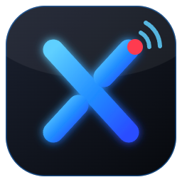

<p align="center"></p>

<h1 align="center">StreamX</h1>

<p align="center"><b>Gravação de tela, captura de jogos, clipes instantâneos e transmissão ao vivo para Windows.</b><br>
Motor do OBS Studio (libobs 32.2.2) com interface, recursos e identidade próprios.</p>

## Recursos

**Essenciais**
- Captura de tela, janela, jogo (DirectX/OpenGL/Vulkan), webcam, microfone, áudio do PC e **áudio de um aplicativo específico**
- Várias cenas e fontes, com visibilidade, bloqueio, ordem, mover e redimensionar direto na prévia
- Transições (esmaecer, corte, deslizar, empurrar, limpar, para cor) com duração ajustável
- Filtros de vídeo (chroma key, correção de cor, recorte, nitidez, máscara…) e de áudio (supressão de ruído RNNoise, ganho, noise gate, compressor, limitador)
- Mixer com medidor em tempo real, fader em dB, mudo, monitoramento e 6 faixas
- Gravação em MP4 híbrido (à prova de queda), MP4, MKV ou MOV, com **multifaixa**
- Transmissão RTMP/RTMPS (Twitch, YouTube, Kick, Facebook… ou servidor personalizado) com reconexão automática
- Codificação por GPU (NVIDIA NVENC, AMD AMF, Intel Quick Sync) ou CPU (x264); só aparecem os codificadores que o PC tem
- Resolução base e de saída, FPS de 24 a 120, atalhos globais configuráveis e perfis

**Exclusivos**
- 🎬 **Clip It**: replay instantâneo de 15, 30, 60 ou 120 s, salvo com um atalho sem parar a gravação, organizado por mês e por jogo, com controle de memória e de disco
- 🎮 **Game Mode**: detecta o jogo, tem presets para Fortnite, Minecraft, GTA V, VALORANT, CS2 e outros, monitora CPU, GPU e RAM, dá sugestões e salva perfis por jogo
- 🎧 **Audio Tracks**: separa microfone, jogo e Discord em faixas e reduz ruído
- ✂ **Editar no FreeCut**: envia gravações e clipes para o editor [FreeCut](https://github.com/freecut-app/FreeCut) ([contrato](docs/FREECUT_INTEGRATION.md))
- 📡 **StreamX Control**: API HTTP local com token, mais uma página de controle para o celular (gravar, transmitir, clipes, cenas e status)
- ✦ **Assistente inteligente**: analisa CPU, GPU, RAM, monitor e codificadores e recomenda resolução, FPS, bitrate e codificador, explicando cada escolha. Funciona offline e sem serviços pagos.

## Atalhos padrão

| Atalho | Ação |
|---|---|
| Ctrl + Alt + R | iniciar/parar gravação |
| Ctrl + Alt + S | iniciar/parar transmissão |
| Ctrl + Alt + C | Clip It: salvar clipe |
| Ctrl + Alt + B | Clip It: ligar/desligar |
| Ctrl + Alt + 1…9 | mudar de cena |

## Compilar

Requisitos: Windows 10/11 x64, Visual Studio 2022 Build Tools (C++ e Windows SDK 10.0.22621+), Git, CMake 3.28–3.30 e NSIS 3.

```powershell
powershell -ExecutionPolicy Bypass -File scripts\build-all.ps1
```

O script clona o OBS Studio 32.2.2, compila o libobs e os plugins sem modificações (preset `streamx` em `scripts/CMakeUserPresets.json`, que baixa sozinho o Qt 6 e o FFmpeg do obs-deps), monta a pasta de execução, compila o StreamX e gera `dist\StreamX-Setup-1.0.0.exe`.

## Estrutura

```
src/core/         Engine (libobs), SceneManager, Recorder, Streamer, ClipIt, Encoders, Settings,
                  Hotkeys, PerfMonitor, GameMode, Hardware (Assistente), Apply
src/control/      StreamX Control (API HTTP local + página remota)
src/integration/  FreeCutBridge
src/ui/           MainWindow, PreviewWidget, MixerWidget, PropertiesView (gerada das propriedades
                  dos plugins), SourceDialogs, SettingsDialog, Pages
installer/        NSIS
```

Detalhes da arquitetura: [ARCHITECTURE.md](ARCHITECTURE.md). Testes: [TESTING.md](TESTING.md).

## Licença

**GPL v2 ou posterior**, porque o StreamX usa o libobs (GPL). Veja [LICENSE](LICENSE) e [THIRD_PARTY_NOTICES.md](THIRD_PARTY_NOTICES.md). O StreamX é um projeto independente, sem afiliação com o OBS Project.
